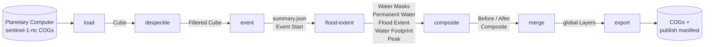

# Overview

`flood-monitoring` maps the extent of a flood from a time series of Sentinel-1 radar images and prepares the result for the brustt.xyz Platform. One command runs the whole chain for one **Event** (one real-world flood, e.g. `saintes-2026-02`).

Terms in **bold** (Event, Series, Cube, Baseline, Drop, Event Start, Water Mask, Permanent Water, Flood Extent, Peak, Composite…) are defined in [`CONTEXT.md`](../CONTEXT.md). Read it first if a word is unclear.

## The idea in one paragraph

Open water reflects radar away from the sensor, so a flooded pixel is much darker (lower VV backscatter) than it normally is. The pipeline reads every Sentinel-1 pass over the **Area of Interest** from well before the flood to after it, removes speckle noise, estimates each pixel's normal backscatter (the **Baseline**), finds the first date on which the flood is visible (the **Event Start**), classifies open water on every date from then on, and removes water that was already there before the flood (**Permanent Water**). What is left, over all post-event dates, is the **Flood Extent**.

## Pipeline



| # | Stage | Reads | Writes | Details |
|---|-------|-------|--------|---------|
| 1 | `load` | STAC COGs | `interim/cube.nc`, `items.parquet` | [ingest](pipeline/1-ingest.md) |
| 2 | `despeckle` | Cube | `interim/filtered-cube.nc`, `window.npz` | [ingest](pipeline/1-ingest.md) |
| 3 | `event` | Filtered Cube | `processed/summary.json` | [detection](pipeline/2-detection.md) |
| 4 | `flood-extent` | Filtered Cube, summary | Water Masks, Permanent Water, `flood-extent.tif`, `water-footprint.tif`, Peak in summary | [detection](pipeline/2-detection.md) |
| 5 | `composite` | Filtered Cube, summary | `before-composite.tif`, `after-composite.tif`, `before-vv.tif`, `after-vv.tif` | [composite](pipeline/3-composite.md) |
| 6 | `merge` | per-orbit results | global Layers, `orbit-map.tif` (multi-orbit only) | [merge](pipeline/4-merge.md) |
| 7 | `export` | processed rasters | `outputs/<event>/*.tif` COGs, publish manifest, archive | [export](pipeline/5-export.md) |

`download` then `stack` build the same Cube from raw Subsets (eo-stac, then eo-pipe). They are out of the default run and kept, through `--stage`, until `load` is validated on Charente ([ingest](pipeline/1-ingest.md)).

Stages 1 to 5 run once per **Series** (one per relative orbit), one orbit after the other. A single-orbit Event keeps flat folders and skips `merge`. The stage order and the per-Series loop live in `src/flood_monitoring/cli.py` (`STAGES`, `PER_SERIES`, `DEFAULT_RUN`, `run_stages`).

## Running it

See [`install.md`](install.md) for the full install (every stage) and the light one (`load` only, e.g. on the VPS).

```bash
uv run flood-monitoring run saintes-2026-02              # whole pipeline, load to export
uv run flood-monitoring run saintes-2026-02 --stage event # one stage
uv run flood-monitoring run saintes-2026-02 --force       # redo stages whose output exists
uv run flood-monitoring run saintes-2026-02 --keep-intermediates  # keep raw/, cube.nc, filtered-cube.nc
uv run flood-monitoring show saintes-2026-02              # config and resolved paths
```

The Event defaults to `saintes-2026-02`. `--stage` runs a single stage; `--force` redoes a stage whose output already exists.

## Skip, resume and force

Every stage skips itself when its output file exists (`skip: <path> exists`) and fails with `run the <x> stage first` when its input is missing. Consequences:

- `load` keeps nothing of an interrupted run: the Cube is written to `cube.nc.part` and renamed once complete, so a killed `load` starts again. Within a run, a chunk that fails to read is retried 3 times (10, 20, 40 s) before the stage fails. `download` (when used) resumes: eo-stac skips the Subsets already on disk.
- `event`, `flood-extent`, `composite` and `merge` delete their own outputs before writing, write rasters as `*.partial` renamed on success and `summary.json` atomically. A stage killed midway is redone by the next run.
- **Intermediates are deleted by default**: `raw/` once the Cube exists (after `stack`), `cube.nc` once the Filtered Cube exists, `filtered-cube.nc` once the Composites exist. `--keep-intermediates` keeps them. A stage up to `despeckle` is skipped when a later requested stage of that orbit is already done (its input was deleted, so it would only rebuild what is no longer needed). To rerun a stage whose input was deleted, run the earlier stages again with `--keep-intermediates`.
- Re-running an upstream stage does **not** invalidate downstream ones. After changing a config value or re-running a stage, run the later stages with `--force`.
- `export` always rewrites its outputs.

## Configuration

Each Event has a file `events/<event>.yaml`. Sections:

| Section | Purpose |
|---------|---------|
| `project`, `event` | slugs shared with the Platform |
| `area_of_interest` | `[west, south, east, north]` in EPSG:4326, or a path to a polygon file (relative to the repo root). With a polygon, only the chunks that touch it (plus the speckle filters' halo) are read and stored |
| `window` | calendar period of the flood shown on the Platform, set by hand. **Not** the Event Start, which is detected |
| `series` | STAC `collection`, `start`/`end` dates, `orbit_state`, `instrument_mode`, `relative_orbit` (one number or a list), `assets` (`[vv, vh]` or `[vv]`) |
| `despeckle` | Lee and Quegan window sizes, `enl` |
| `detection` | thresholds of the detection rules, see [detection](pipeline/2-detection.md) |
| `composite` | dB ranges stretched for display, also the manifest's display ranges |
| `event_grid` | CRS and pixel size of the merged grid (multi-orbit only) |
| `processing` | `memory_budget_mb` (every stage) and `io_threads` (COG reads in flight per `load` chunk, default 8), see the README |

`events/saintes-2026-02.yaml` is the reference, with every detection value at its default.

## Where files go

Data lives outside the repo, under `$FLOOD_MONITORING_DATA_ROOT` (default `~/Documents/Projects/data/flood-monitoring`); only `outputs/` and `publish/` are in the repo.

```
<data root>/
  raw/<event>/                    downloaded Subsets (+ metadata/), only with download + stack
  interim/<event>/                cube.nc, filtered-cube.nc (deleted by default once used),
                                  items.parquet (the STAC Items of the Cube), window.npz (the Filtered Cube's chunks)
  processed/<event>/              summary.json, flood-extent.tif, water-footprint.tif, permanent-water.tif,
                                  before-composite.tif, after-composite.tif, before-vv.tif, after-vv.tif,
                                  water-masks/<date>.tif
  external/                       polygon Areas of Interest, by hand
  outputs/<timestamp>/<event>/    archive copy of the final Layers, one per export
<repo>/
  outputs/<event>/                final Layers (COGs), git-ignored
  publish/<event>.publish.yaml    manifest for the Platform
  publish/project.yaml            Project metadata, written by hand once
```

For a multi-orbit Event every per-Series folder gets an extra `orbit-<n>/` level (`interim/<event>/orbit-8/`, `processed/<event>/orbit-8/` …), and the merged global files sit directly under `processed/<event>/`.

`scripts/flush_event.py <event> [--all]` (local, not in the repo) deletes an Event's interim and processed data (and raw with `--all`).

## Design decisions

- [`detection-rules.md`](detection-rules.md): how the thresholds were chosen on Saintes, and what was tried and rejected.
- [`adr/0001-one-series-per-orbit-merge-never-average.md`](adr/0001-one-series-per-orbit-merge-never-average.md): why orbits are processed separately and merged on results, never on backscatter.
- [`xarray-dask-rewrite.md`](xarray-dask-rewrite.md): the bounded-memory design of the stages after download (#26), as designed then.
- [`aquitaine-charente-orbits.md`](aquitaine-charente-orbits.md): orbits, disk, network and memory of the first three-orbit Event.
- `specs/run-folders-and-band-names.md` (local draft, not in the repo): per-run folders and band-tagged names.

## Code map

| Module | Role |
|--------|------|
| `cli.py`, `_env.py` | entry point, stage loop (each stage imported when it runs), clean GDAL environment re-exec |
| `config.py`, `paths.py` | Event YAML to dataclasses; every input/output path |
| `load.py` | stage 1: the Cube from the STAC COGs (odc-stac) |
| `download.py`, `stack.py` | the same Cube from raw Subsets (eo-stac, eo-pipe), out of the default run |
| `despeckle.py`, `cube.py` | stage 2; the Cube's int16 dB storage, windowed writing and checks |
| `detection.py`, `event.py`, `flood_extent.py` | detection kernels and stages 3-4 |
| `composite.py` | stage 5, int16 encoding of Composites |
| `merge.py`, `merge_stage.py` | merge kernels (pure) and stage 6 (I/O) |
| `export.py` | stage 7 |
| `chunks.py`, `raster.py`, `aoi.py` | memory planning (a copy of eo-pipe's planner), crash-safe raster writes and sieve, Area of Interest masks and chunk windows |
